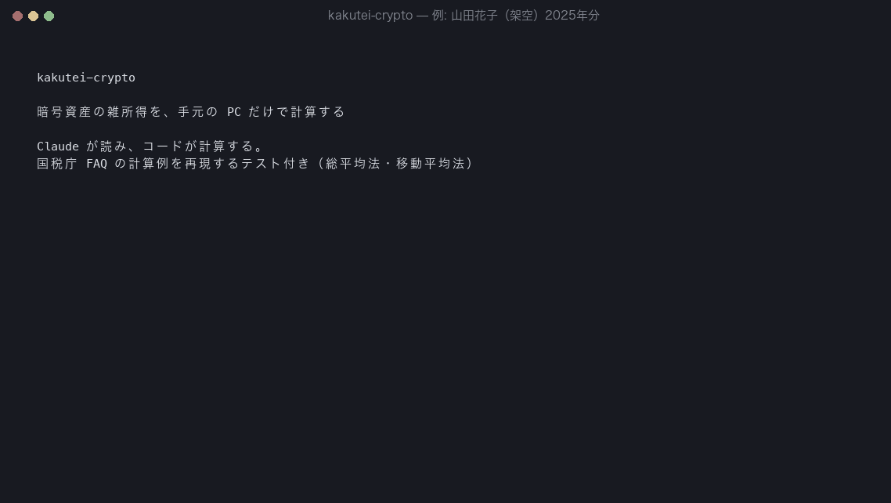

# kakutei-crypto

**暗号資産の確定申告を、手元のパソコンだけで。Claude が「読む」、コードが「計算する」。**



国内の交換業者からダウンロードした取引履歴（CSV・PDF）を、ひとつの統一台帳にまとめ、
**総平均法・移動平均法**で暗号資産の雑所得を計算します。結果は国税庁「暗号資産の計算書」と同じ欄構成で、xlsx に出力します。

```
$ kakutei calc ledger.csv manual/*.ledger.csv
■ 2025年分 暗号資産の計算書（総平均法）
  BTC    A=0.2  B=2,000,000  C=0.1  D=1,500,000  E=11,666,666  F=0.15  G=1,750,000  H=0.15  I=1,750,000  収入=2,400,000
  ETH    A=0  B=0  C=1.01  D=506,000  E=500,990  F=0.505  G=253,000  H=0.505  I=253,000  収入=310,000
  ...
  所得金額                      722,400 円
```

## なぜ作ったか

- 交換業者ごとに CSV の形式がバラバラで、PDF の報告書しか出ない業者もある。国税庁の計算書（Excel）に手で転記するのは大変。
- 既存の損益計算サービスは便利だが、**全取引履歴をクラウドにアップロードする**必要がある。
- LLM に計算までさせると、**数字の正しさを保証できない**。

そこで役割を分けました。

| 工程 | 担当 | 理由 |
|---|---|---|
| CSV・PDF を読んで統一台帳にする | **Claude Code**（`/crypto-tax` スキル）＋既知形式のパーサー | 形式の違いを吸収するのは LLM が得意 |
| 整合性チェック・所得計算・帳票出力 | **決定的な Python コード**（Decimal、テスト済み） | 税額は再現性と検証可能性が必要 |

台帳（`ledger.csv`）は人が読める CSV なので、Claude が作った行も必ず人が確認できます。

## 信頼できる理由

- **国税庁 FAQ の計算例をそのままテストにしています**（「暗号資産等に関する税務上の取扱いについて（FAQ）」令和7年12月改訂）
  - 2-4: 総平均法の売却原価 **3,106,000 円**、移動平均法 **3,080,200 円**
  - 2-8: 2 つの交換業者をまたいだ所得 **2,189,000 円**
  - 1-3（交換）、1-5（購入手数料）、1-6（分裂）、1-7（ステーキング報酬）
- 金額・数量はすべて `Decimal`。float は使いません。
- 合成データの例（`examples/yamada-2025/`）は、手計算の過程を [`EXPECTED.md`](examples/yamada-2025/EXPECTED.md) に書き、テストで一致を確認しています。
- `kakutei check` が、時価の欠落・保有数量のマイナス（取込み漏れ）・対応する送付のない受取を検出し、**エラーがある限り計算しません**。

## インストール

```bash
git clone https://github.com/wizlanish/kakutei-crypto.git
cd kakutei-crypto
pip install .          # kakutei コマンドが使えるようになる
```

Claude Code のプラグインとして使う場合:

```
/plugin marketplace add wizlanish/kakutei-crypto
/plugin install kakutei-crypto@kakutei-crypto
```

## 使い方

### Claude Code で（おすすめ）

取引履歴を置いたフォルダで Claude Code を起動し、`/crypto-tax` と入力します。
Claude がファイルを確認し、既知形式は取り込み、PDF などは台帳の行を作ってあなたに確認を求め、チェックを通してから `kakutei calc` を実行します。

### コマンドだけで

```bash
kakutei import ~/税金/2025/*.csv -o ledger.csv       # 既知形式を統一台帳に
kakutei check  ledger.csv manual/*.ledger.csv          # 取込み漏れ・時価の欠落をチェック
kakutei calc   ledger.csv manual/*.ledger.csv --xlsx 計算書.xlsx            # 総平均法
kakutei calc   ledger.csv manual/*.ledger.csv --method moving              # 移動平均法
```

例をそのまま試す:

```bash
kakutei import examples/yamada-2025/*.csv -o /tmp/ledger.csv
kakutei calc /tmp/ledger.csv examples/yamada-2025/manual/*.ledger.csv
```

### 対応している形式

| 交換業者 | ファイル | 方法 |
|---|---|---|
| OKJ | 履歴データ（CSV）の注文履歴・入出金口座履歴 | パーサー |
| Coincheck | 取引履歴「様式1」CSV | パーサー |
| bitFlyer ほか | 月次の取引報告書 PDF、その他の CSV | Claude Code が台帳化 |

## 税務上の扱い

| 取引 | 扱い | FAQ |
|---|---|---|
| 円で購入 | 取得。取得価額 = 支払額 + 購入手数料 | 1-5 |
| 円で売却 | 譲渡。売却手数料は必要経費 | 1-1, 2-3 |
| 暗号資産同士の交換 | 手放した側を時価で譲渡、受け取った側を同じ時価で取得 | 1-3 |
| ステーキング・レンディング等の報酬 | 受取時の時価を収入に計上し、同額で取得 | 1-7 |
| 分裂（分岐） | 取得価額 0 円 | 1-6 |
| 自分の口座間の送付 | 所得なし。同じ銘柄は全交換業者で合算して計算 | 2-8 |
| 暗号資産で払った送付手数料 | 収入 0 円で譲渡（※） | — |

※「時価で譲渡し、同額を必要経費にする」処理と所得金額は同じになるため、時価が要らないこちらを採用しています。

**端数**: 計算は Decimal で行い、円未満は表示時に切り捨てます。総平均法の年末金額 I は円未満を切り捨て、売却原価は G = B + D − I（計算書と同じ式）で求めます。

## 対象外（今後の予定）

証拠金・CFD・信用取引 / DeFi・NFT / 海外交換業者（外貨換算） / 法人 / 時価の自動取得 / Web 画面

## 免責

このツールは計算の補助です。税務上の判断や申告内容の最終確認は、ご自身（必要に応じて税理士・税務署）で行ってください。

---

### English summary

`kakutei-crypto` computes Japanese crypto-asset miscellaneous income (雑所得) locally using the total-average (総平均法) and moving-average (移動平均法) methods. A Claude Code skill (`/crypto-tax`) reads heterogeneous exchange CSVs and PDF statements into a unified, human-reviewable ledger; all tax arithmetic is done by deterministic, `Decimal`-based Python code whose tests reproduce the National Tax Agency's own FAQ examples. **Claude reads; code calculates.**
